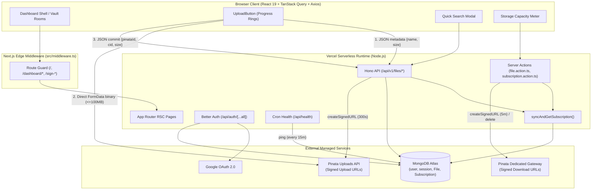
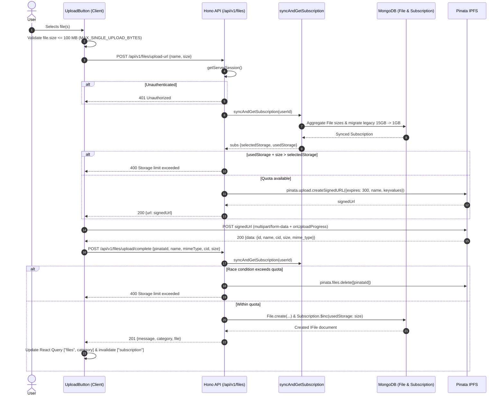
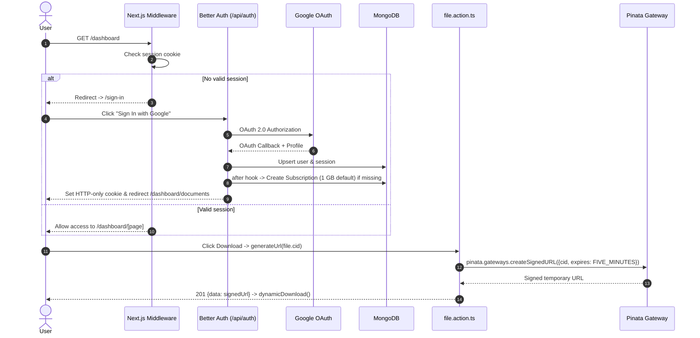
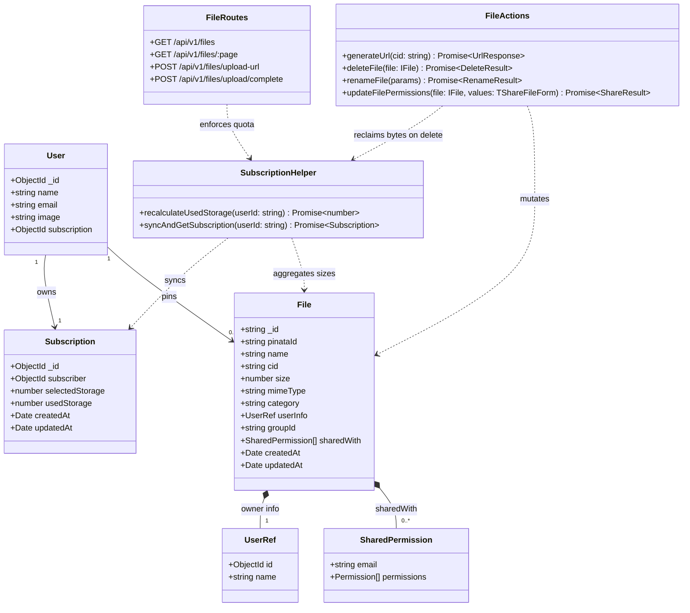
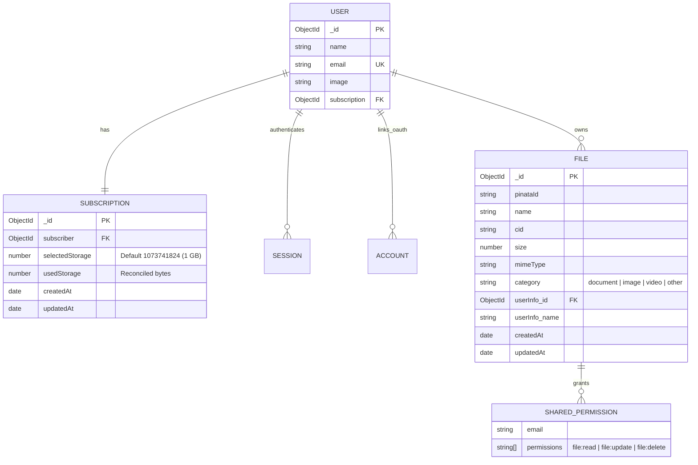
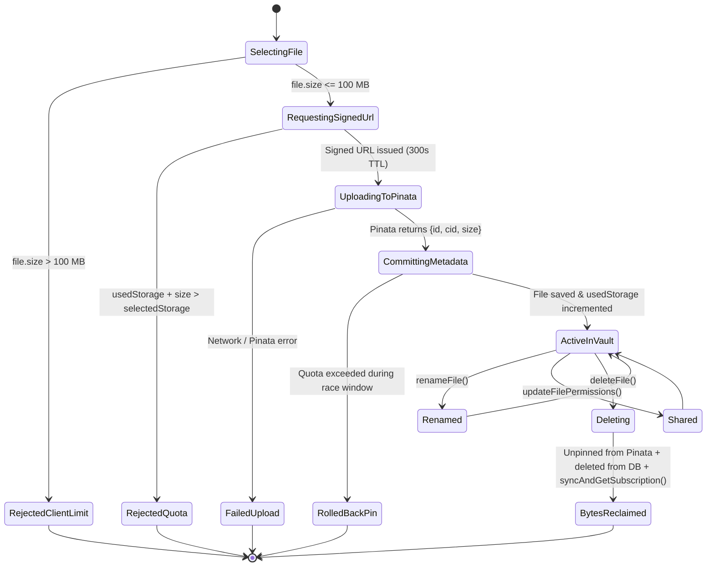

<div align="center">
  
  <h1>KipVault</h1>
  <p><strong>Lock it. Pin it. Keep it.</strong><br />Editorial-grade cloud file vault and permissioned sharing platform backed by Pinata IPFS.</p>

  <p>
    
    
    
    
    
    
    
    
  </p>
</div>

---

## Table of Contents

1. [Overview](#overview)
2. [Core Capabilities](#core-capabilities)
3. [System Architecture](#system-architecture)
4. [UML Diagrams](#uml-diagrams)
   - [UML Sequence: Direct-to-Pinata Upload Flow](#uml-sequence-direct-to-pinata-upload-flow)
   - [UML Sequence: Authentication, Session & Download Flow](#uml-sequence-authentication-session--download-flow)
   - [UML Class Diagram](#uml-class-diagram)
   - [Entity-Relationship Diagram (ERD)](#entity-relationship-diagram-erd)
   - [UML State Diagram: File & Quota Lifecycle](#uml-state-diagram-file--quota-lifecycle)
5. [Tech Stack](#tech-stack)
6. [Design System & UI Architecture](#design-system--ui-architecture)
7. [MIME Classification & Vault Rooms](#mime-classification--vault-rooms)
8. [Storage Quota, Limits & Reconciliation](#storage-quota-limits--reconciliation)
9. [Security & Permissions Model](#security--permissions-model)
10. [API & Server Actions Reference](#api--server-actions-reference)
11. [Project Structure](#project-structure)
12. [Getting Started](#getting-started)
13. [Deployment & Vercel Keep-Alive](#deployment--vercel-keep-alive)
14. [Troubleshooting](#troubleshooting)

---

## Overview

**KipVault** is a full-stack cloud file vault and permissioned sharing platform built with **Next.js 15 App Router**, **Hono**, **Better Auth**, **MongoDB**, and **Pinata IPFS**.

Every uploaded asset is pinned directly from the browser to **Pinata IPFS** using short-lived server-issued signed upload URLs—completely bypassing Vercel's `4.5 MB` serverless request body limit while supporting files up to **`100 MB` per upload** inside a **`1 GB` Pinata Free Tier-aligned default vault quota**. File metadata, ownership, and granular per-recipient permissions are persisted in MongoDB, while downloads are served over **5-minute signed Pinata Gateway URLs**.

The interface is crafted around the **KipVault Editorial Design System**: high-contrast `#ffffff` Paper surfaces, `#0d0d0d` Ink structural borders, `#fbda5f` Butter Highlights, `#edeef0` Fog rooms, and `#006aff` Signal Blue accents, paired with **Phudu** uppercase display typography, **Inter** UI typography, and crisp **Lucide** line icons.

---

## Core Capabilities

| Capability | Description |
| :--- | :--- |
| **Direct-to-Pinata Uploads** | Browser requests a 5-minute signed upload URL (`POST /api/v1/files/upload-url`), streams `multipart/form-data` straight to Pinata (`<= 100 MB` per file), and commits metadata via `POST /api/v1/files/upload/complete`—zero `413 Payload Too Large` errors on Vercel. |
| **Self-Healing Quota Accounting** | Auto-provisions a `1 GB` (`1,073,741,824` bytes) subscription on sign-in, migrates legacy `15 GB` defaults automatically, reconciles `usedStorage` from MongoDB `File` records, and immediately reclaims bytes when files are deleted. |
| **Automatic Vault Rooms** | Classifies uploads by MIME type into **Documents**, **Images**, **Videos**, and **Others** (including PDFs, Office suites, plain text/CSV, media, audio, and archives). |
| **Scoped Email Sharing** | Shares any owned file with teammates by email with explicit `file:read`, `file:update`, and `file:delete` permissions verified server-side. |
| **Signed Gateway Downloads** | Generates expiring (`5 min`) Pinata Gateway URLs via `generateUrl(cid)` so private vault content is never exposed via permanent unauthenticated links. |
| **Real-Time Multi-File Progress** | Supports concurrent multi-file selection (`Promise.allSettled`) with per-file circular SVG progress meters and instant TanStack Query cache updates. |
| **Collapsible Icon-Rail Sidebar** | Smoothly collapses from `16rem` to a centered `4.5rem` (`72px`) icon rail with right-side tooltips, compact mark logo, and quick-search trigger. |
| **Infinite Scroll & Quick Search** | Paginates vault rooms (`9` items/page via `react-intersection-observer`) alongside a debounced (`300ms`) modal search across owned files. |
| **Google OAuth + Keep-Alive Cron** | Better Auth session management backed by MongoDB plus a `/api/health` cron endpoint every 15 minutes to keep serverless MongoDB connections warm. |

---

## System Architecture



---

## UML Diagrams

### UML Sequence: Direct-to-Pinata Upload Flow

This two-phase signed upload design eliminates Vercel's `4.5 MB` serverless payload limit while preserving strict server-side authentication and storage quota enforcement:



---

### UML Sequence: Authentication, Session & Download Flow



---

### UML Class Diagram



---

### Entity-Relationship Diagram (ERD)



---

### UML State Diagram: File & Quota Lifecycle



---

## Tech Stack

| Layer | Technology | Version / Details |
| :--- | :--- | :--- |
| **Framework** | Next.js (App Router, Turbopack) | `15.5.29`, React `19`, TypeScript `5` |
| **Styling & UI** | Tailwind CSS + Radix UI + shadcn/ui | Tailwind `3.4`, `class-variance-authority`, Sonner |
| **Iconography** | Lucide React + Custom Brand SVGs | Crisp `2px`-stroke line icons + `KipVaultLogo` & `KebabMenuIcon` |
| **Typography** | Google Fonts (`next/font/google`) | `Phudu` (display headings) & `Inter` (UI & body) |
| **API Layer** | Hono + Next.js Server Actions | Hono `4.6` (`hono/vercel` Node.js runtime at `/api/v1`) |
| **Client Data & Forms** | TanStack Query + React Hook Form + Zod + Axios | React Query `5`, Zod `3.24`, Axios `1.7` |
| **Authentication** | Better Auth | `1.1.11` (Google OAuth 2.0 + MongoDB adapter + cookies) |
| **Database** | MongoDB + Mongoose | `mongodb 6.12` + `mongoose 8.9` |
| **IPFS Storage** | Pinata SDK | `pinata 1.10.1` (Signed upload URLs, deletion, signed gateways) |
| **Hosting & Cron** | Vercel | Serverless Node.js functions + 15-minute health cron |

---

## Design System & UI Architecture

KipVault uses custom design tokens defined in [`tailwind.config.ts`](./tailwind.config.ts) and [`src/app/globals.css`](./src/app/globals.css):

| Token | Value | Usage |
| :--- | :--- | :--- |
| `paper` | `#ffffff` | Primary card, sidebar, and header surface |
| `ink` | `#0d0d0d` | `1.5px` crisp borders, primary typography, active rings |
| `butter` | `#fbda5f` | Active navigation pills, primary CTAs, storage banner, logo mark |
| `fog` | `#edeef0` | Dashboard canvas background, input pills, hover surfaces |
| `signal` | `#006aff` | Interactive links, breadcrumb root, image quick-open hover |
| `pure-black` | `#000000` | High-contrast auth showcase & inverted footer bands |
| `mist` / `silver` | `#999999` / `#cccccc` | Muted metadata, placeholders, section dividers |

### Sidebar & Icon Behavior
- **Expanded (`16rem`)**: Full `<KipVaultLogo />` wordmark, rounded-pill `Quick search...` trigger, `Vault Rooms` section label, and pill navigation links (`bg-butter border-ink` when active).
- **Collapsed (`4.5rem` / `72px`)**: Centered geometric mark logo, centered `40x40` search icon button with right-side tooltip, clean hairline divider, and centered `40x40` navigation buttons with `Lucide` icons (`FileText`, `Image`, `Film`, `Layers`, `Users`, `HardDrive`) and hover tooltips.

---

## MIME Classification & Vault Rooms

[`getCategoryFromMimeType()`](./src/lib/utils.ts#L54-L68) automatically routes uploaded files into the appropriate dashboard room:

| Vault Room | Route | Stored `category` | Matched MIME Types |
| :--- | :--- | :--- | :--- |
| **Documents** | `/dashboard/documents` | `document` | `application/pdf`, Word (`.doc`/`.docx`), Excel (`.xls`/`.xlsx`), PowerPoint (`.ppt`/`.pptx`), `application/rtf`, `text/plain`, `text/csv`, `text/markdown` |
| **Images** | `/dashboard/images` | `image` | All `image/*` MIME types |
| **Videos** | `/dashboard/videos` | `video` | All `video/*` MIME types |
| **Others** | `/dashboard/others` | `other` (queries `["other", "audio"]`) | Audio (`audio/*`), ZIP/archives, binaries, and any other MIME types |
| **Shared with me** | `/dashboard/shared` | Aggregated via `sharedWith.email` | Any file where `sharedWith` contains the signed-in user's email |
| **Storage** | `/dashboard/storage` | N/A | Live capacity meter (`StorageCard`) backed by `syncAndGetSubscription()` |

---

## Storage Quota, Limits & Reconciliation

All storage constants are centralized in [`src/lib/contants.ts`](./src/lib/contants.ts):

| Constant | Value | Purpose |
| :--- | :--- | :--- |
| `DEFAULT_STORAGE_LIMIT` | `1073741824` (`1 GB`) | Default `Subscription.selectedStorage` aligned with Pinata Free Tier (`1 GB` / `500` pins). |
| `LEGACY_DEFAULT_STORAGE_LIMIT` | `16105174016` (`~15 GB`) | Automatically migrated to `DEFAULT_STORAGE_LIMIT` when existing accounts are read or synced. |
| `MAX_SINGLE_UPLOAD_BYTES` | `104857600` (`100 MB`) | Maximum single-request `POST` file size enforced before issuing a Pinata signed upload URL. |
| `FIVE_MINUTES` | `300000` (`5 min`) | Expiration window for signed Pinata gateway download URLs. |

### How Self-Healing Quota Works
1. **Pre-upload check**: `/api/v1/files/upload-url` runs `syncAndGetSubscription(userId)` and rejects files exceeding `MAX_SINGLE_UPLOAD_BYTES` (`100 MB`) or `selectedStorage - usedStorage`.
2. **Post-upload commit**: `/api/v1/files/upload/complete` re-validates quota against race conditions (deleting the orphan pin from Pinata if exceeded) before inserting into `File` and incrementing `usedStorage`.
3. **Reclaim on delete**: `deleteFile()` verifies ownership or `file:delete` permission, removes the file from Pinata and MongoDB, and runs `syncAndGetSubscription(ownerId)` so `usedStorage` is recalculated directly from MongoDB (`File.aggregate`) and never drifts.

---

## Security & Permissions Model

- **Session Enforcement**:
  - Edge middleware (`src/middleware.ts`) guards `/dashboard/*` and redirects authenticated users away from `/sign-in` and `/sign-up`.
  - Every API route under `/api/v1/files/*` and Server Action (`deleteFile`, `getSubscription`) verifies the Better Auth session via `getServerSession()`.
- **File Sharing Permissions**:
  - Owners can share files by email with any combination of `file:read`, `file:update`, and `file:delete`.
  - `deleteFile` enforces server-side that the caller is either the owner (`userInfo.id === session.user.id`) or has `file:delete` in `sharedWith` for their email.
  - UI menus also gate Rename (`file:update`), Share (owner-only), Download (`file:read`), and Delete (`file:delete`).
- **Zero Exposed Pinata Secrets**:
  - `PINATA_JWT` remains strictly server-side (`"server only"` in `src/lib/pinata/config.ts`).
  - Browsers only ever receive single-purpose signed upload URLs (`300s` TTL) and signed gateway download URLs (`5m` TTL).
- **Cron Protection**:
  - `/api/health` enforces `Authorization: Bearer <CRON_SECRET>` when `CRON_SECRET` is configured.

---

## API & Server Actions Reference

### HTTP Endpoints

| Method | Endpoint | Auth | Description |
| :--- | :--- | :---: | :--- |
| `GET`/`POST` | `/api/auth/[...all]` | Public | Better Auth OAuth, callback, session, and sign-out handler. |
| `GET` | `/api/health` | `CRON_SECRET` (optional) | Pings MongoDB (`admin.ping()`) to keep Atlas connections warm. |
| `GET` | `/api/v1/files?search=<query>` | Session | Case-insensitive filename search scoped to the authenticated user. |
| `GET` | `/api/v1/files/:category?page=<n>` | Session | Paginated file list (`9` files/page) for `document`, `image`, `video`, `other` (includes legacy `audio`), or aggregated `shared` files. |
| `POST` | `/api/v1/files/upload-url` | Session | Validates `{ name, size }` (`<= 100 MB` & within quota) and returns `{ url }` from `pinata.upload.createSignedURL({ expires: 300 })`. |
| `POST` | `/api/v1/files/upload/complete` | Session | Validates `{ pinataId, name, mimeType, cid, size }`, verifies quota, creates the MongoDB `File` document, and increments `usedStorage`. |

### Server Actions

| Action | Module | Purpose |
| :--- | :--- | :--- |
| `generateUrl(cid)` | `src/action/file.action.ts` | Generates a signed Pinata gateway URL valid for 5 minutes (`FIVE_MINUTES`). |
| `renameFile({ file, values })` | `src/action/file.action.ts` | Updates the file's display `name` in MongoDB by `pinataId`. |
| `updateFilePermissions(file, values)` | `src/action/file.action.ts` | Upserts an entry in `sharedWith` (`email` + `permissions`: `file:read`, `file:update`, `file:delete`). |
| `deleteFile(file)` | `src/action/file.action.ts` | Verifies session & ownership/`file:delete` permission, deletes from Pinata & MongoDB, and recalculates owner `usedStorage`. |
| `getSubscription()` | `src/action/subscription.action.ts` | Runs `syncAndGetSubscription(session.user.id)` and returns the live `Subscription` document. |
| `getServerSession()` | `src/action/auth.action.ts` | Reads the active Better Auth session from request headers. |

---

## Project Structure

```text
kipvault/
├── .env.example                               # Environment variable template
├── package.json
├── tailwind.config.ts                         # KipVault design tokens, fonts, and radii
├── vercel.json                                # Vercel 15-min keep-alive cron (/api/health)
├── public/
│   ├── kipvault-logo.svg                      # Full KipVault vector lockup
│   ├── document.png                           # Category artwork (Documents)
│   ├── image.png                              # Category artwork (Images)
│   ├── video.png                              # Category artwork (Videos)
│   ├── other.png                              # Category artwork (Others/Archive)
│   └── not-found.png                          # Empty vault room illustration
└── src/
    ├── middleware.ts                          # Auth guard & / -> /dashboard redirect
    ├── action/
    │   ├── auth.action.ts                     # getServerSession()
    │   ├── file.action.ts                     # generateUrl, deleteFile, renameFile, updateFilePermissions
    │   └── subscription.action.ts             # getSubscription() via syncAndGetSubscription
    ├── app/
    │   ├── icon.svg / favicon.ico / apple-icon.png
    │   ├── globals.css                        # CSS variables & base typography rules
    │   ├── layout.tsx                         # Root layout, fonts, metadata, providers
    │   ├── (auth)/
    │   │   ├── layout.tsx                     # Split Pure Black / Paper auth layout
    │   │   ├── sign-in/page.tsx
    │   │   ├── sign-up/page.tsx
    │   │   └── _components/auth-form.tsx      # Google OAuth card
    │   ├── (dashboard)/
    │   │   ├── layout.tsx                     # Sidebar + Header + Fog vault shell
    │   │   ├── dashboard/
    │   │   │   ├── page.tsx                   # Redirects /dashboard -> /dashboard/documents
    │   │   │   └── [page]/
    │   │   │       ├── page.tsx               # Dynamic vault room & storage route
    │   │   │       └── _components/
    │   │   │           ├── page-files.tsx     # Infinite scroll grid & empty state
    │   │   │           └── page-subscription.tsx # Always-fresh Storage capacity page
    │   │   └── _components/
    │   │       ├── app-sidebar.tsx            # Collapsible 16rem / 4.5rem icon-rail sidebar
    │   │       ├── breadcrumb.tsx
    │   │       ├── header.tsx
    │   │       ├── header-profile.tsx
    │   │       ├── search-bar.tsx             # Pill search trigger + Search Vault dialog
    │   │       ├── uplaod-button.tsx          # Direct-to-Pinata multi-file uploader
    │   │       ├── file-card/{card.tsx,menu.tsx}
    │   │       └── subscription/subs-widget.tsx
    │   └── api/
    │       ├── auth/[...all]/route.ts         # Better Auth endpoint
    │       ├── health/route.ts                # MongoDB ping cron endpoint
    │       └── v1/
    │           ├── [[...route]]/route.ts      # Hono API entry (/api/v1)
    │           └── _routes/file.route.ts      # Search, pagination, upload-url, upload/complete
    ├── components/
    │   ├── brand/{logo.tsx,category-badge.tsx}
    │   ├── custom/{p.tsx,sidebar-trigger.tsx}
    │   ├── icons/kebab.tsx
    │   ├── styles/button.ts
    │   └── ui/*                               # KipVault-styled Radix/shadcn primitives
    ├── context/query-provider.tsx
    ├── hooks/{use-mobile.tsx,use-toast.ts}
    ├── lib/
    │   ├── contants.ts                        # Time, quota (1 GB), & upload (100 MB) constants
    │   ├── env.ts                             # Environment variable exports
    │   ├── utils.ts                           # MIME classification, size formatting, helpers
    │   ├── better-auth/{auth.ts,auth-client.ts,auth-types.ts,db.ts}
    │   ├── database/
    │   │   ├── db.ts
    │   │   ├── subscription.helper.ts         # recalculateUsedStorage & syncAndGetSubscription
    │   │   └── schema/{file.model.ts,subscription.model.ts}
    │   ├── fetch/files.fetch.tsx
    │   └── pinata/config.ts
    └── props/types.ts
```

---

## Getting Started

### 1. Prerequisites

* **Node.js 20+** (or **Bun**)
* **MongoDB** cluster (e.g., MongoDB Atlas)
* **Google Cloud OAuth 2.0** client credentials
* **Pinata** account with a JWT and dedicated IPFS Gateway URL

### 2. Install Dependencies

```bash
npm install
# or
bun install
```

### 3. Configure Environment Variables

Copy `.env.example` to `.env` in the project root and populate every key:

```bash
cp .env.example .env
```

| Variable | Required | Description |
| :--- | :---: | :--- |
| `NEXT_PUBLIC_APP_URL` | Yes | Public application origin (e.g., `http://localhost:3000`). |
| `BETTER_AUTH_SECRET` | Yes | High-entropy 32+ character secret for session signing (`openssl rand -hex 32`). |
| `BETTER_AUTH_URL` | Yes | Base URL used by Better Auth client and server (`http://localhost:3000`). |
| `MONGODB_URI` | Yes | MongoDB connection string used by both Mongoose and Better Auth's adapter. |
| `GOOGLE_CLIENT_ID` | Yes | Google OAuth 2.0 Client ID. |
| `GOOGLE_CLIENT_SECRET` | Yes | Google OAuth 2.0 Client Secret. |
| `PINATA_JWT` | Yes | Pinata API JWT with file upload, signed-URL, and deletion permissions. |
| `NEXT_PUBLIC_GATEWAY_URL` | Yes | Pinata gateway domain used to sign file download URLs. |
| `CRON_SECRET` | No | Optional bearer secret for `/api/health` scheduled requests on Vercel. |

> **Google OAuth Redirect URI:** Register `<BETTER_AUTH_URL>/api/auth/callback/google` in your Google Cloud Console OAuth credentials.

### 4. Run & Verify Locally

```bash
npm run dev       # Start local development server with Turbopack
npx tsc --noEmit  # Run TypeScript type checks
npm run lint      # Run ESLint across the codebase
npm run build     # Create optimized production build
npm run start     # Serve production build locally
```

Open [`http://localhost:3000`](http://localhost:3000). Unauthenticated requests redirect to `/sign-in`; authenticated requests land in `/dashboard/documents`.

---

## Deployment & Vercel Keep-Alive

1. Push the repository to GitHub and import it into **Vercel**.
2. Add all environment variables from `.env.example` into **Vercel Project Settings -> Environment Variables** (setting `NEXT_PUBLIC_APP_URL` and `BETTER_AUTH_URL` to your production `https://...` domain).
3. Update Google Cloud Console Authorized Redirect URIs to include `https://<your-domain>/api/auth/callback/google`.
4. [`vercel.json`](./vercel.json) automatically registers the **`mongodb-keep-alive`** cron job, which hits `GET /api/health` every 15 minutes (`*/15 * * * *`) to prevent cold database disconnections.

---

## Troubleshooting

| Symptom | Cause | Resolution |
| :--- | :--- | :--- |
| `413 Payload Too Large` on upload | Sending file bytes through a Vercel Serverless Function (`4.5 MB` hard cap). | Resolved by direct-to-Pinata signed URLs (`/api/v1/files/upload-url` -> Pinata -> `/api/v1/files/upload/complete`). |
| Upload rejected over `100 MB` | Pinata v3 single-`POST` upload endpoints cap at `100 MB` (`MAX_SINGLE_UPLOAD_BYTES`). | Files `> 100 MB` require TUS chunked uploads; current single-POST cap is enforced cleanly in UI and API. |
| Storage page showed `15.00 GB` | Legacy `Subscription` document created before the `1 GB` alignment. | Automatically migrated to `1.00 GB` (`1073741824` bytes) and reconciled on next `Storage` visit or upload via `syncAndGetSubscription()`. |
| Pinata rejects upload before `1 GB` in-app | Pinata Free Tier enforces `1 GB` and `500` total pins across the Pinata account. | Delete unused files in KipVault (bytes are reclaimed automatically) or upgrade your Pinata plan. |
| `Unauthorized` on `/api/health` | `CRON_SECRET` is set without matching `Authorization: Bearer <CRON_SECRET>` header. | Ensure Vercel Cron sends the `CRON_SECRET` configured in Vercel environment variables. |
